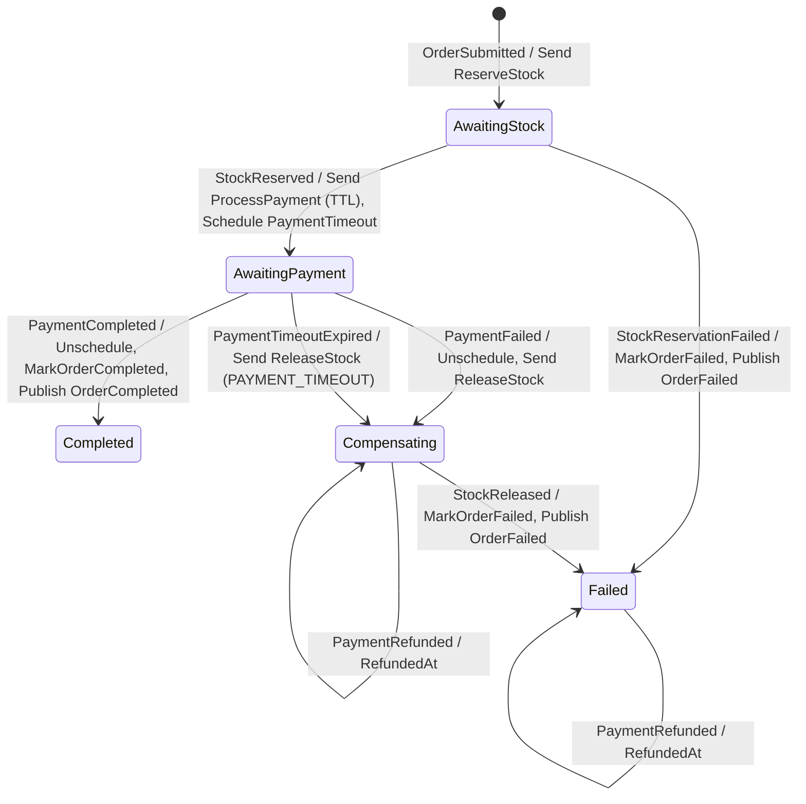

# CLAUDE.md — Distributed Saga

Production-ready "Dağıtık İşlem ve Saga Pattern" altyapısı (CV portfolyosu): **Order**, **Stock** ve **Payment**
servisleri; MassTransit State Machine ile orchestration saga; Transactional Outbox; idempotent consumer'lar;
compensation (stok iadesi, ödeme iadesi).

## Teknik kararlar (değiştirmeden önce kullanıcıya sor)

- **Framework:** Hedef `net9.0` (`Directory.Build.props`). Makinede .NET 10 SDK var; `global.json`
  `rollForward: latestMajor` ile onu kullanır. **.NET 9 SDK kurma.** Makinede .NET 9 runtime da yok;
  `Directory.Build.props`'taki `RollForward=Major` sayesinde test/API'ler .NET 9 runtime varsa onu, yoksa .NET 10'u kullanır.
- **MassTransit 8.x** (şu an 8.5.11). **v9 ticari lisanslı, ASLA v9'a yükseltme.** RabbitMQ transport,
  `MassTransit.EntityFrameworkCore` ile Transactional Outbox.
- **PostgreSQL + EF Core (Npgsql), code-first.** Database-per-service: `order_db`, `stock_db`, `payment_db`; her biri
  ayrı kullanıcıyla (`order_svc`, `stock_svc`, `payment_svc`), kullanıcılar yalnızca kendi DB'sine bağlanabilir.
  Bkz. `.env.example`, `deploy/postgres/init/01-init-databases.sh`.
- **Central Package Management:** Sürümler **yalnızca** `Directory.Packages.props`'ta. `.csproj`'lara `Version` yazma.
- **Kalite kapısı (`Directory.Build.props`):** `TreatWarningsAsErrors`, `Nullable`, `ImplicitUsings`,
  `EnforceCodeStyleInBuild`, `AnalysisLevel=latest`. `.editorconfig`: file-scoped namespace (warning → hata),
  private alanlar `_camelCase`, LF satır sonu, BOM'suz UTF-8.
- **Clean Architecture:** `X.API → X.Infrastructure → X.Application → X.Domain`. Domain hiçbir projeye bağımlı değil.
  `Shared.Contracts` bağımlılıksız (yalnızca event/command sözleşmeleri). `BuildingBlocks.Messaging` ortak
  MassTransit/RabbitMQ/Outbox konfigürasyonu.
- **Servisler arası senkron HTTP çağrısı YOK.** Tüm iletişim RabbitMQ üzerinden event/command.
- **Zamanlayıcı:** MassTransit.Quartz (in-process) + Postgres job store (servisin kendi DB'sinde `quartz` şeması).
  RabbitMQ delayed-exchange plugin'i kullanılmaz (bekleyen mesajlar replike edilmez).
- **Idempotency:** MessageId tekrarı MassTransit Inbox (`InboxState`) ile; üstüne iş anahtarları (unique index).
  Kendi "ProcessedMessages" tablonu yazma.

## Klasör yapısı

```
DistributedSaga/
├── src/
│   ├── BuildingBlocks/
│   │   ├── Shared.Contracts/          # Event & command sözleşmeleri (bağımlılıksız)
│   │   └── BuildingBlocks.Messaging/  # MassTransit + RabbitMQ + Outbox ortak config (→ Shared.Contracts)
│   └── Services/
│       ├── Order/    Order.Domain · Order.Application · Order.Infrastructure · Order.API
│       ├── Stock/    Stock.Domain · Stock.Application · Stock.Infrastructure · Stock.API
│       └── Payment/  Payment.Domain · Payment.Application · Payment.Infrastructure · Payment.API
├── tests/            Order.UnitTests · Stock.UnitTests · Payment.UnitTests (xUnit; → Domain + Application + Messaging)
│                     Shared.Contracts.Tests (sözleşme mimari testleri, reflection)
│                     BuildingBlocks.Messaging.Tests (retry sınıflandırması)
├── deploy/postgres/init/01-init-databases.sh   # İlk açılışta DB + kullanıcıları oluşturur
├── docker-compose.yml · .env.example (.env git'e girmez)
├── Directory.Build.props · Directory.Packages.props · global.json · .editorconfig
├── scaffold.sh                                  # Solution iskeleti (idempotent)
├── dotnet-tools.json                            # Yerel araçlar: dotnet-ef 9.0.x (dotnet tool restore)
└── DistributedSaga.sln
```

Proje referansları: `X.Application → X.Domain, Shared.Contracts` · `X.Infrastructure → X.Application,
BuildingBlocks.Messaging` · `X.API → X.Application, X.Infrastructure`.

Order servisi içi:

```
Order.Domain/Orders/          Order (aggregate) · OrderItem · OrderStatus · domain exception'ları
Order.Application/Orders/     SubmitOrderHandler · RequestHasher · IOrderRepository/IUnitOfWork
Order.Application/Saga/       OrderStateMachine · OrderState · activity'ler · PaymentTimeoutExpired · OrderSagaOptions
Order.Infrastructure/         OrderDbContext · EF configuration'ları · Migrations · Sql/quartz_tables_postgres.sql
                              Saga/OrderStateDefinition (retry + outbox) · DependencyInjection (MassTransit, Quartz)
Order.API/                    Minimal API (Endpoints/) · ProblemDetails eşlemesi · composition root
```

BuildingBlocks.Messaging: `AddMessaging<TDbContext>` (RabbitMQ + EF outbox + bus outbox), `QueueNames` +
`CommandEndpoints.Map()` (command → kuyruk eşlemesi), `TransientDatabaseRetry`, `.env`/connection string yardımcıları.

## Komutlar

```bash
# İlk kurulum
cp .env.example .env
./scaffold.sh                       # idempotent: var olan projeleri atlar, tekrar çalıştırılabilir

# Build / test (sıfır uyarı beklenir; uyarılar build'i kırar)
dotnet build DistributedSaga.sln
dotnet test DistributedSaga.sln
dotnet list DistributedSaga.sln package --outdated   # MassTransit'i yalnızca 8.x içinde güncelle

# EF Core migration (Order)
dotnet tool restore
dotnet ef migrations add <Ad> -p src/Services/Order/Order.Infrastructure -s src/Services/Order/Order.API -o Persistence/Migrations
dotnet ef migrations bundle -p src/Services/Order/Order.Infrastructure -s src/Services/Order/Order.API   # production

# Order API (Development; .env kökten okunur, migration startup'ta uygulanır)
dotnet run --project src/Services/Order/Order.API          # http://localhost:5100
OrderSaga__PaymentTimeout=00:00:10 dotnet run --project src/Services/Order/Order.API   # kısa timeout ile
curl -i -X POST localhost:5100/orders -H 'Content-Type: application/json' -H 'Idempotency-Key: demo-1' \
  -d '{"customerId":"6f1c2b8e-3a4d-4f5e-9a7b-1c2d3e4f5a6b","currency":"TRY","items":[{"productId":"a1a1a1a1-0000-0000-0000-000000000001","quantity":2,"unitPrice":150}]}'
curl localhost:5100/orders/<id>
curl localhost:5100/internal/orders/<id>/saga               # yalnızca Development: saga state
curl localhost:5100/health/ready                           # Postgres + RabbitMQ

# Altyapı
docker compose up -d                # postgres + rabbitmq
docker compose ps                   # ikisi de (healthy) olmalı
docker compose --profile tools up -d   # + pgAdmin (http://localhost:5050)
docker compose down                 # durdur (veri volume'larda kalır)
docker compose down -v              # volume'larla birlikte sil → init script bir sonraki açılışta yeniden çalışır

# Doğrulama
docker exec saga-postgres psql -U saga_admin -d postgres -c '\l'
docker exec saga-rabbitmq rabbitmqctl list_vhosts
docker exec saga-rabbitmq rabbitmqctl list_queues -p saga name messages_ready consumers
```

RabbitMQ UI: http://localhost:15672 (vhost `saga`) · PostgreSQL: `localhost:5432`.

## Mesaj sözleşmeleri (Shared.Contracts)

Orchestration saga: akışı Order servisindeki MassTransit state machine yönetir. Event'ler publish (fan-out),
command'lar ilgili servisin kuyruğuna send (point-to-point) edilir.

```
Shared.Contracts/
├── Common/    OrderItemDto · ReasonCodes
├── Orders/    Events/   OrderSubmitted · OrderCompleted · OrderFailed
├── Stock/     Commands/ ReserveStock · ReleaseStock
│              Events/   StockReserved · StockReservationFailed · StockReleased
└── Payments/  Commands/ ProcessPayment · RefundPayment
               Events/   PaymentCompleted · PaymentFailed · PaymentRefunded
```

| Mesaj | Tip | Publisher | Consumer |
|---|---|---|---|
| `OrderSubmitted` | Event | Order servisi (outbox) | Order saga (başlatır) |
| `ReserveStock` | Command | Order saga | Stock servisi |
| `StockReserved` | Event | Stock servisi | Order saga → `ProcessPayment` |
| `StockReservationFailed` | Event | Stock servisi | Order saga → `OrderFailed` (telafi yok) |
| `ProcessPayment` | Command | Order saga | Payment servisi |
| `PaymentCompleted` | Event | Payment servisi | Order saga → `OrderCompleted` |
| `PaymentFailed` | Event | Payment servisi | Order saga → `ReleaseStock` |
| `ReleaseStock` | Command (compensation) | Order saga | Stock servisi |
| `StockReleased` | Event | Stock servisi | Order saga → `OrderFailed` |
| `OrderCompleted` | Event | Order saga | Order servisi (sipariş durumu), dış dinleyiciler |
| `OrderFailed` | Event | Order saga | Order servisi (sipariş durumu), dış dinleyiciler |
| `RefundPayment` | Command (compensation) | Order saga (timeout sonrası geç `PaymentCompleted`) | Payment servisi |
| `PaymentRefunded` | Event | Payment servisi | Order saga (`RefundedAt` kaydı) |
| `PaymentTimeoutExpired` *(iç, Shared.Contracts'ta değil)* | Schedule | Order saga → Quartz | Order saga |

Akışlar:
- **Happy path:** `OrderSubmitted → ReserveStock → StockReserved → ProcessPayment → PaymentCompleted → OrderCompleted`
- **Stok yetersiz:** `… → ReserveStock → StockReservationFailed → OrderFailed`
- **Ödeme başarısız:** `… → ProcessPayment → PaymentFailed → ReleaseStock → StockReleased → OrderFailed`
- **Ödeme timeout:** `… → ProcessPayment (TTL) → PaymentTimeoutExpired → ReleaseStock → StockReleased → OrderFailed(PAYMENT_TIMEOUT)`
- **Timeout sonrası geç ödeme:** Compensating/Failed'de `PaymentCompleted → RefundPayment → PaymentRefunded`

### Sözleşme kuralları

- Shared.Contracts **sıfır paket/proje bağımlılığı**; MassTransit tipleri (`CorrelatedBy<Guid>` vb.) yok.
  Correlation saga'da `CorrelateById(x => x.Message.OrderId)` ile.
- Her mesaj `public sealed record`, property'ler `{ get; init; }`; ilk sürüm alanları `required`.
  **Versiyonlama:** yeni alan yalnızca `required` olmadan, varsayılan değerle eklenir; alan silinmez/yeniden adlandırılmaz.
- **Namespace + tip adı wire contract'tır:** MassTransit exchange adını tam tip adından üretir
  (örn. `Shared.Contracts.Stock.Events:StockReserved`). Taşımak/yeniden adlandırmak routing'i kırar.
- İsimlendirme: event'ler geçmiş zaman (`Reserved|Completed|Failed|Released|Submitted|Refunded`), command'lar emir
  kipi; `Event`/`Command` soneki yok. Namespace: `Shared.Contracts.<Orders|Stock|Payments>.<Commands|Events>`;
  bunların dışındaki public tipler yalnızca `Shared.Contracts.Common`'da.
- Her mesajda `Guid OrderId` (correlation anahtarı); event'lerde `OccurredAt`, command'larda `RequestedAt`
  (`DateTimeOffset`, publisher `DateTimeOffset.UtcNow` kullanır).
- Para: `decimal Amount` + `string Currency` (ISO 4217). Toplamı Order domain'i hesaplar, saga yeniden hesaplamaz.
- Hata event'lerinde `Reason` (insan için) + `ReasonCode` (`Common.ReasonCodes`: `INSUFFICIENT_STOCK`,
  `PRODUCT_NOT_FOUND`, `PAYMENT_DECLINED`, `PAYMENT_TIMEOUT`, `PAYMENT_ERROR`, `VALIDATION_ERROR`).
  Compensation/raporlama koda göre karar verir.
- Bu kurallar `tests/Shared.Contracts.Tests` ile korunur.

### Idempotency kuralları

- **Kendi "ProcessedMessages" tablonu yazma.** `MessageId` düzeyindeki tekrarı MassTransit EF Core outbox'ıyla gelen
  **Inbox (`InboxState`)** çözer. Contract'lara ayrıca mesaj ID'si eklenmez.
- Bizim katmanımız **iş anahtarlarıdır** (saga aynı komutu yeni `MessageId` ile tekrar gönderebilir; Inbox bunu yakalamaz):
  - **Payment:** `OrderId` unique (sipariş başına tek tahsilat). Tekrar gelen `ProcessPayment` yeniden tahsilat yapmaz,
    mevcut sonucu (`PaymentCompleted`/`PaymentFailed`) yeniden publish eder.
  - **Stock:** rezervasyon `OrderId` ile unique. Tekrar gelen `ReserveStock` mevcut sonucu yeniden publish eder.
  - Sınır: "reddedilen ödemeyi başka kartla tekrar dene" veya kısmi iade gelirse `PaymentAttemptId`/`RefundId`
    gerekir (optional alan olarak, geriye uyumlu eklenir).
- **Stok rezervasyonu ya hep ya hiç:** bir kalem bile yetersizse hiçbir kalem rezerve edilmez, `StockReservationFailed` döner.
- **Compensation komutları iş açısından başarısız olamaz** (`ReleaseStock`, `RefundPayment`); yalnızca teknik retry.
  Rezervasyon/tahsilat yoksa veya zaten serbest bırakılmış/iade edilmişse yine `StockReleased`/`PaymentRefunded`
  publish edilir, aksi halde saga takılır. Bu yüzden `ReleaseFailed`/`RefundFailed` event'i **yoktur**.

## Order servisi ve saga (Adım 3)

### API

| Uç | Davranış |
|---|---|
| `POST /orders` | `Idempotency-Key` header zorunlu. İlk istek **202 Accepted** + `Location`; aynı key + aynı body **200** (mevcut sipariş); aynı key + farklı body **422**. Validation **400** (ProblemDetails). |
| `GET /orders/{id}` | `status` (Pending/Completed/Failed), `reasonCode`, `reason`, tutar, kalemler. Yoksa 404. |
| `GET /internal/orders/{id}/saga` | **Yalnızca Development.** Saga'nın iç state'i; public API sözleşmesinin parçası değil. |
| `/health/live` · `/health/ready` | live: bağımlılık kontrolü yok · ready: Postgres (`AddDbContextCheck`) + MassTransit bus |

- **Idempotency-Key (IETF taslağı davranışı):** `Orders.IdempotencyKey` unique index. Siparişte `RequestHash` =
  kanonik JSON'un SHA-256'sı (alan sırası sabit, kalemler ProductId'ye göre sıralı, decimal sondaki sıfırlar atılmış;
  key hash'e dahil değil). Eşzamanlı aynı key: kaybeden istek 23505 alır, değişiklikleri atılır, kazananın siparişi döner.
- `OrderSubmitted` bus outbox ile siparişle **aynı SaveChanges**'te `OutboxMessage`'a yazılır; broker'a delivery service taşır.
- **Fiyat istemciden geliyor: bilinçli sadeleştirme, gerçek sistemde fiyat katalogdan okunur.**
- Domain kuralları: en az bir kalem, adet > 0, fiyat > 0, aynı ürün tek kalemde, para birimi `^[A-Z]{3}$`;
  `TotalAmount` domain'de hesaplanır. `Complete()`/`Fail()` yalnızca Pending'den; aynı duruma tekrar geçiş no-op,
  çapraz geçiş (Completed → Failed vb.) `InvalidOrderStateTransitionException` (API'de 409).

### Saga state diyagramı



Listelenmeyen her (state, event) çifti **açıkça `Ignore()`** edilir (çift/geç teslim saga'yı hata kuyruğuna düşürmez).
`OrderSagaIgnoreMatrixTests` her state'te tüm işlenmeyen event'leri gönderir; bir Ignore unutulursa test kırılır.
Instance'ı olmayan bir event (bilinmeyen OrderId) ise bilinçli olarak fault → error kuyruğu (bug görünür olsun).

### Kararlar ve gerekçeleri

- **Saga kalemleri state'te (`OrderState.Items`, jsonb).** Saga Order tablosundan okumaz; saga'nın ihtiyacı olan veri
  `OrderSubmitted` ile gelir. `ProcessPayment.Amount/Currency` = `OrderSubmitted.TotalAmount/Currency` (yeniden hesaplanmaz).
- **Tek DbContext, tek transaction.** Saga repository (`ExistingDbContext<OrderDbContext>`), `MarkOrderCompleted`/
  `MarkOrderFailed` activity'leri (Order aggregate'ini günceller, kendileri SaveChanges çağırmaz) ve EF outbox aynı
  scoped `OrderDbContext`'i kullanır: saga state + sipariş durumu + giden mesajlar atomik commit edilir.
  `OrderCompleted`/`OrderFailed` yalnızca dış dünya içindir; sipariş durumunu güncellemek için tüketilmezler.
- **Completed/Failed final değil (`Finalize`/`SetCompletedWhenFinalized` yok).** Saga kaydı denetim izi olarak kalır
  (hangi state'ten, hangi sebeple, ne zaman) ve bu state'lerde geç gelen event'ler (örn. timeout sonrası
  `PaymentCompleted`) hâlâ karşılanabilir. Kayıt silinseydi geç event "missing instance" olarak hataya düşerdi.
  Temizlik/arşivleme gerekirse ayrı bir retention job'ı ile yapılır.
- **Optimistic concurrency (Postgres `xmin`).** `OrderState.RowVersion` ve Order'da shadow `RowVersion` (`uint`,
  `IsRowVersion()`) fiziksel kolon eklemeden `xmin`'e eşlenir. Pessimistic kilit yerine çakışmada retry.
- **Endpoint filtre sırası:** `UseMessageRetry` (dışta) → `UseEntityFrameworkOutbox` (içte). Her deneme yeni transaction;
  inbox (`InboxState`) MessageId tekrarını, outbox giden mesajları saga state ile aynı transaction'a bağlar.
- **Retry kapsamı (`TransientDatabaseRetry`, Stock/Payment de kullanacak):** `DbUpdateConcurrencyException`;
  `DbUpdateException` + 23505 (Initial'da aynı CorrelationId ile eşzamanlı insert — retry'da instance bulunur);
  `NpgsqlException.IsTransient`. Üstel bekleme (5 deneme, 50 ms–2 s, delta 100 ms; MassTransit aralığı ±%20 rastgele
  seçer = jitter). Domain exception'ları (`OrderDomainException`) `Ignore` edilir.
- **Timeout: Quartz (MassTransit.Quartz, in-process) + Postgres ADO job store** (`order_db`, `quartz` şeması,
  `TablePrefix = quartz.qrtz_`, SystemTextJson serializer, clustering açık → birden fazla API instance'ı aynı job'u
  iki kez çalıştırmaz). RabbitMQ delayed-exchange plugin'i seçilmedi: bekleyen mesajlar tek node'da tutulur,
  replike edilmez. Quartz tabloları resmi script'ten (`Persistence/Sql/quartz_tables_postgres.sql`) EF migration ile kurulur.
- **`PaymentTimeout` (varsayılan 30 sn, `OrderSaga:PaymentTimeout`) iki katmanlıdır:**
  1. `ProcessPayment` **TimeToLive = PaymentTimeout** ile gönderilir: timeout'tan sonra kuyrukta bekleyen bayat komut
     Payment'a hiç ulaşmaz (RabbitMQ siler) → gereksiz tahsilat + iade sayısı azalır.
  2. Aynı süreyle `PaymentTimeoutExpired` schedule edilir; `PaymentCompleted`/`PaymentFailed` gelince `Unschedule`.
  TTL tek başına yetmez: Payment komutu TTL dolmadan almış ve işliyor olabilir. Bu yüzden Compensating/Failed'de gelen
  geç `PaymentCompleted` için **bir kez** `RefundPayment` gönderilir (`RefundRequestedAt`); `PaymentRefunded` gelince
  `RefundedAt` yazılır, sipariş Failed kalır. Unschedule ile yarışan geç timeout Completed/Compensating/Failed'de Ignore edilir.
- **Bilinen risk (kabul edildi):** timeout sonrası geç ödeme → para çekilir, sipariş Failed olur, sonra iade edilir.
  Müşteri kısa süreliğine çift hareket görebilir.

### Migration ve konfigürasyon

- **Development:** API startup'ta `Database.Migrate()` çalıştırır. **Production'da startup'ta migrate edilmez**
  (çoklu instance yarışı, şema yetkisi): `dotnet ef migrations bundle` ile üretilen bundle CI/CD'de ayrı adım olarak çalışır.
- Secret'lar repoda değil. Development'ta API kökteki `.env`'yi INI provider ile okur (anahtarlar `.env` ile aynı:
  `ORDER_DB_USER`, `RABBITMQ_PASSWORD` …); ortam değişkenleri `.env`'yi ezer. Container'da aynı anahtarlar ortam
  değişkeni olarak verilir. `appsettings.json` yalnızca secret olmayan varsayılanları içerir.

### Test stratejisi (Order.UnitTests)

- Domain (geçişler, invariant'lar, toplam), `RequestHasher` (sıra bağımsızlığı), `SubmitOrderHandler` (fake repository).
- Saga: `AddMassTransitTestHarness` + in-memory saga repository + fake `IOrderRepository`. Zamanlayıcı olarak Quartz yerine
  **in-memory delayed scheduler** (saga arkadaki scheduler'ı bilmez). Harness'ta zamanı ileri alan API yok; timeout
  testleri `PaymentTimeout = 250 ms` ile çalışır (gerçek ama kısa bekleme). Quartz kurulumu Adım 5 entegrasyon testinde.
- Bekleme: harness'ın `Any()`'si inactivity timeout'a bağlı (Exists() yoklamaları aktivite sayılmaz) ve mesaj işlenmeden
  false dönebiliyor; testler kayıtlı mesajları senkron yoklar (`WaitUntilAsync`).

## Adım 4 için notlar

- Stock/Payment **kuyruk adları sabit**: `QueueNames` (`stock-reserve-stock`, `stock-release-stock`,
  `payment-process-payment`, `payment-refund-payment`). Consumer endpoint'leri bu adlarla açılmalı.
- `AddMessaging<TDbContext>` + endpoint'te `UseMessageRetry(r => r.UseTransientDatabaseRetry(...))` →
  `UseEntityFrameworkOutbox<TDbContext>`; iş anahtarları: Stock rezervasyonu ve Payment tahsilatı `OrderId` unique.
- Payment `RefundPayment` consumer'ı: tahsilat yoksa/zaten iade edildiyse de `PaymentRefunded` (Amount = fiilen iade edilen).
- Domain/application katmanında `Stock` kök namespace'i ile `Shared.Contracts.Stock` çakışabilir (bkz. tuzaklar).

## Notlar / tuzaklar

- .NET 10 SDK şablonları `-f net9.0` kabul etmez; `scaffold.sh` şablonları `-f`'siz üretir, `<TargetFramework>`,
  `<Nullable>`, `<ImplicitUsings>` satırlarını csproj'dan siler (merkezi props'tan gelir) ve CRLF/BOM'u temizler.
- MSBuild XML yorumlarında `--` kullanılamaz (props dosyası yüklenemez).
- Init script yalnızca **boş** postgres volume'unda çalışır; DB/kullanıcı değişikliği için `docker compose down -v`.
- **Kök namespace = tip adı çakışması:** `Order` kök namespace'i ve `Order` aggregate'i. `Order.Domain.Orders` dışında
  `Order` adı namespace'e çözülür (CS0118). Aggregate'i kullanan dosyalarda `using Order.Domain.Orders;` **namespace
  bildiriminden sonra** yazılır (namespace düzeyindeki using, kök namespace'ten önce aranır).
- **`.env` ve `AddIniFile`:** `PhysicalFileProvider` varsayılan olarak `.` ile başlayan dosyaları gizler; optional bir
  kaynak sessizce boş kalır. `ExclusionFilters.None` ile provider verilmeli (bkz. `ConfigurationExtensions`).
- **C# 14 (.NET 10 SDK, LangVersion=latest):** dizilerde `.Reverse()` artık `Span` üzerindeki in-place (void) metoda
  bağlanır; `Enumerable.Reverse(...)` kullanın.
- EF migration dosyaları block-scoped namespace ile üretilir; `.editorconfig`'te `Migrations/` `generated_code = true`.
  `scaffold.sh` normalizasyonu EF'in yazdığı BOM'u da temizler (zararsız).
- `dotnet ef` migration'ı ilk çalıştırmada `__EFMigrationsHistory` yok diye bir "Failed executing DbCommand" logu
  basar; beklenen davranıştır.

## Yol haritası

- [x] **Adım 1** — Solution iskeleti + yerel altyapı (postgres, rabbitmq)
- [x] **Adım 2** — Shared.Contracts (event/command sözleşmeleri + mimari testler)
- [x] **Adım 3** — Order servisi + Saga (MassTransit State Machine, EF Core saga repository, Outbox, Quartz timeout)
- [ ] **Adım 4** — Stock/Payment consumer'ları (idempotent, outbox)
- [ ] **Adım 5** — Hata ve compensation testleri (stok iadesi, ödeme iadesi)

Bir sonraki adıma kullanıcı açıkça söylemeden geçme.
