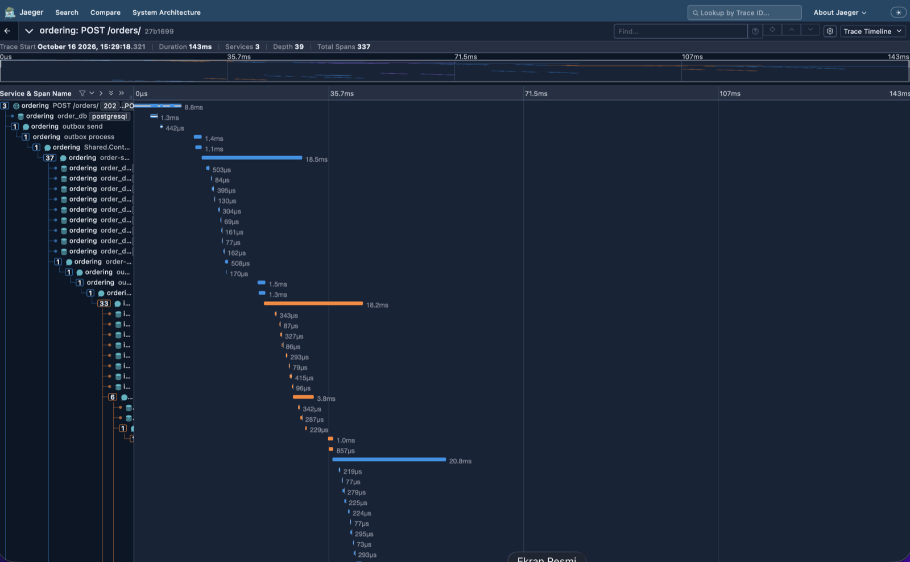
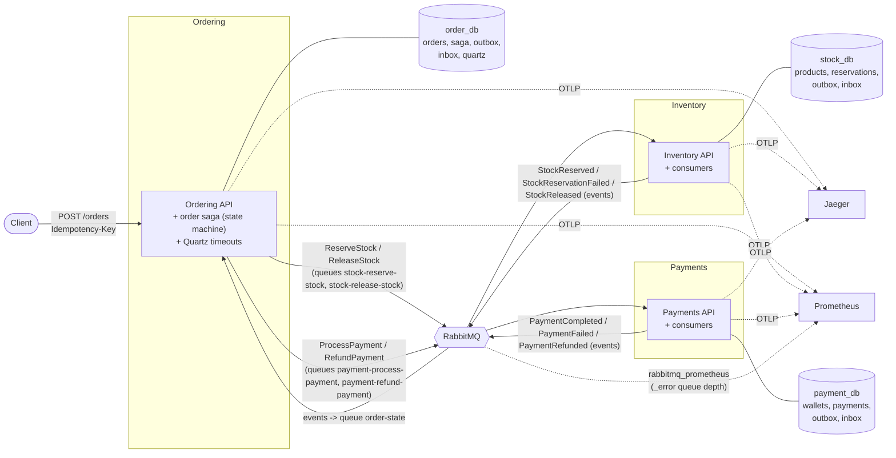
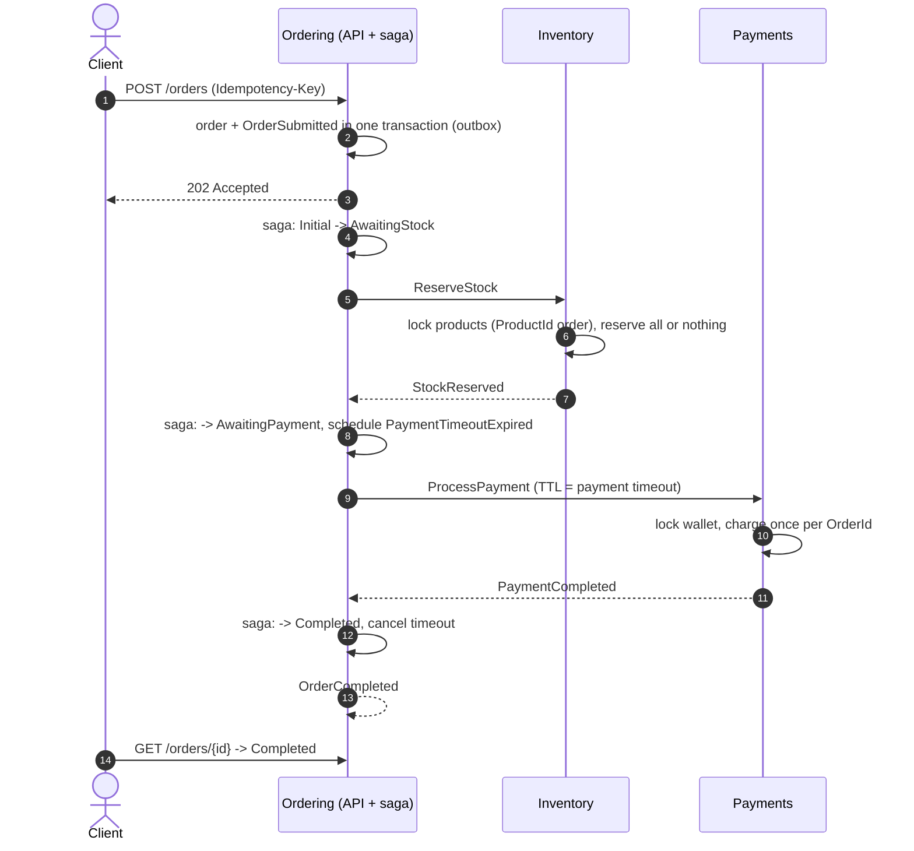
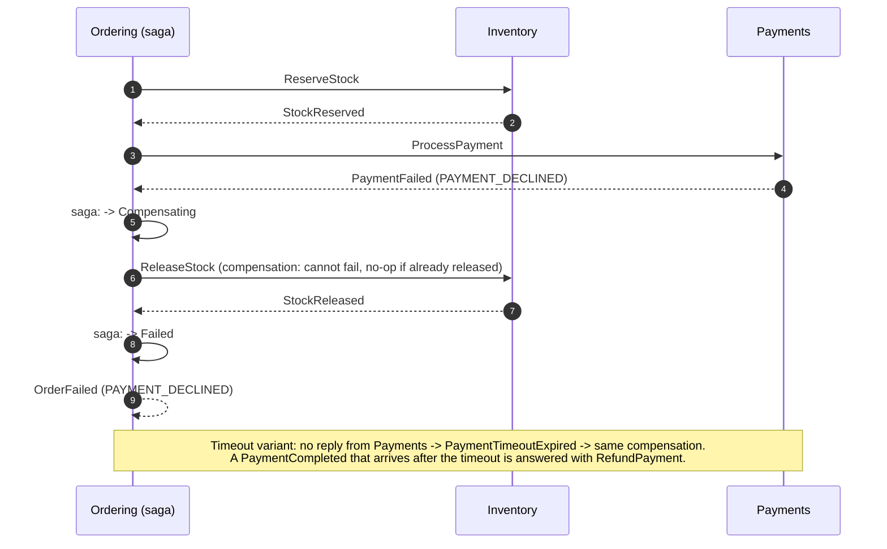

# Distributed Saga

[](https://github.com/OWNER/REPO/actions/workflows/ci.yml)

An order-processing backend that keeps three independently deployed services consistent without distributed transactions:
**Ordering** runs an orchestration saga (MassTransit state machine) that coordinates **Inventory** (stock reservation) and
**Payments** (wallet charging) over RabbitMQ. Every service owns its PostgreSQL database and talks to the others only through
messages. It uses the transactional outbox and inbox, idempotent consumers, pessimistic locking where contention is real,
compensation (stock release, payment refund), a timeout for a payment that never arrives, and end-to-end OpenTelemetry tracing.
The guarantees below are each proven by a test that runs against real Postgres and RabbitMQ (Testcontainers).

> **Language note:** the code and this README are in English. The documents under [`docs/`](docs) (design notes, ADRs, test
> guide, troubleshooting) are written in Turkish.

.NET 9 · MassTransit 8 (Apache-2.0; v9 is commercial, see [ADR-002](docs/decisions.md)) · RabbitMQ 4.1 · PostgreSQL 17 · EF Core · Quartz · OpenTelemetry

## Quick start

Requires only Docker (the images build the .NET code).

```bash
cp .env.example .env && docker compose --profile app up -d --build
```

The first build takes several minutes (SDK image pull, restore, three self-contained migration bundles); later builds hit the
layer cache. The `migrator` job applies the EF migrations, then the three APIs start (all containers are `healthy` when done):

| Service | URL | Database |
|---|---|---|
| Ordering | http://localhost:5100 | `order_db` |
| Inventory | http://localhost:5200 | `stock_db` |
| Payments | http://localhost:5300 | `payment_db` |
| RabbitMQ UI | http://localhost:15672 (vhost `saga`, credentials in `.env`) | |

Place an order and watch it travel through the three services:

```bash
curl -i -X POST localhost:5100/orders -H 'Content-Type: application/json' -H "Idempotency-Key: $(uuidgen)" \
  -d '{"customerId":"6f1c2b8e-3a4d-4f5e-9a7b-1c2d3e4f5a6b","currency":"TRY","items":[{"productId":"a1a1a1a1-0000-0000-0000-000000000001","quantity":2,"unitPrice":150}]}'
curl localhost:5100/orders/<id>                      # Pending -> Completed
curl localhost:5100/internal/orders/<id>/saga        # saga state
curl localhost:5200/internal/reservations/<id>       # Inventory's view
curl localhost:5300/internal/payments/<id>           # Payments' view
```

> `/internal/*` are unauthenticated diagnostic endpoints and the compose stack seeds demo data. **Demo only:** both are
> behind flags (`InternalEndpoints:Enabled`, `Seed:Enabled`) that default to *off*; only Development and this compose demo turn
> them on (the API logs a warning at startup if `InternalEndpoints` is enabled in Production).

Seed data (fixed ids): customer `6f1c2b8e-3a4d-4f5e-9a7b-1c2d3e4f5a6b` has 1,000,000 TRY, `b2b2b2b2-0000-0000-0000-000000000002`
has 100 TRY; products `a1a1a1a1-0000-0000-0000-00000000000{1,2,3,4}` have 100, 50, **0**, 10 units.

### End-to-end scenarios

```bash
./scripts/e2e.sh --compose    # against the compose stack (leaves it running)
./scripts/e2e.sh              # or: build + run the three services with `dotnet run` (needs `docker compose up -d` and .NET SDK)
```

| # | Scenario | Expected |
|---|---|---|
| 1 | Happy path | `Completed`; stock −2, balance −300 |
| 2 | Out-of-stock product | `Failed` (`INSUFFICIENT_STOCK`); wallet untouched |
| 3 | Customer with too little balance | `Failed` (`PAYMENT_DECLINED`); stock reserved, then released |
| 4 | Payments is down | `ProcessPayment` waits in its queue, saga times out → `Failed` (`PAYMENT_TIMEOUT`), stock released; when Payments returns the stale command has expired (TTL), nothing is charged |

### Tracing, metrics, logs

```bash
docker compose --profile app --profile observability up -d --build
./scripts/verify-trace.sh     # places an order, asserts ONE Jaeger trace spans ordering + inventory + payments
```

Jaeger http://localhost:16686 · Prometheus http://localhost:9090. Every log line carries `TraceId` and `OrderId` (as log
scopes), and every saga transition is one line: `Order <id> saga state: AwaitingStock -> AwaitingPayment`.

<!-- TODO(author): add the screenshot of a trace from Jaeger at docs/images/jaeger-trace.png -->


## Architecture



Commands go to fixed queues (point-to-point), events are published (fan-out). There is no synchronous HTTP between services.
Layering inside each service: `API → Infrastructure → Application → Domain`; `Shared.Contracts` has no dependencies.

### Happy path



### Payment declined -> compensation



## Guarantees

Details on how each test proves its guarantee (including mutation checks that deliberately break the mechanism):
[`docs/testing.md`](docs/testing.md) (Turkish).

| Guarantee | Proven by |
|---|---|
| **All-or-nothing stock**: stock never goes negative, no overselling | [50 parallel reservations for 10 units reserve exactly 10](tests/IntegrationTests/ConcurrencyTests.cs#L34) + DB `CHECK ("AvailableQuantity" >= 0)` |
| **No deadlocks** on multi-product orders | [60 parallel orders with opposite item orders](tests/IntegrationTests/ConcurrencyTests.cs#L73): no `40P01`, `pg_stat_database.deadlocks` unchanged |
| **No double charge**: balance never negative, one charge per order | [20 parallel payments exceeding the balance](tests/IntegrationTests/ConcurrencyTests.cs#L139) · [two concurrent commands for one order](tests/IntegrationTests/IdempotencyTests.cs#L106) |
| **Idempotent consumption**: a redelivered message has one effect | [same MessageId, stock](tests/IntegrationTests/IdempotencyTests.cs#L21) · [same MessageId, payment](tests/IntegrationTests/IdempotencyTests.cs#L42) · [new MessageId, same OrderId, stock](tests/IntegrationTests/IdempotencyTests.cs#L66) · [… payment](tests/IntegrationTests/IdempotencyTests.cs#L85) |
| **No lost messages**: transactional outbox | [`POST /orders` returns 202 with the broker down; the saga resumes when it returns](tests/IntegrationTests/OutboxOutageTests.cs#L21) |
| **Saga happy path and early failure** | [happy path](tests/IntegrationTests/SagaTests.cs#L18) · [insufficient stock, payment never attempted](tests/IntegrationTests/SagaTests.cs#L34) |
| **Compensation**: stock release and payment refund | [declined payment releases stock](tests/IntegrationTests/SagaTests.cs#L50) · [payment completing after the timeout is refunded (real Quartz)](tests/IntegrationTests/SagaTests.cs#L70) |
| **Consistency under failure**: transient errors are retried, permanent ones are parked | [transient failures retried until the order completes](tests/IntegrationTests/FaultInjectionTests.cs#L16) · [permanent failure lands in `_error`, saga times out and compensates](tests/IntegrationTests/FaultInjectionTests.cs#L38) |
| **Every saga state handles every late or duplicate event** | [transition / ignore matrix](tests/Ordering.UnitTests/Saga/OrderSagaIgnoreMatrixTests.cs) |
| **Request idempotency**: same `Idempotency-Key` + same body replays, different body is 422 | [`SubmitOrderHandlerTests`](tests/Ordering.UnitTests/Application/SubmitOrderHandlerTests.cs) |
| **Wire contracts are frozen**: namespaces, type and queue names | [`ContractArchitectureTests`](tests/Shared.Contracts.Tests/ContractArchitectureTests.cs) · [`InternalMessageNameTests`](tests/Ordering.UnitTests/Saga/InternalMessageNameTests.cs) |
| **Fault injection cannot run in Production** | [`FaultInjectionProductionTests`](tests/IntegrationTests/FaultInjectionProductionTests.cs) |
| **Demo flags default off** (seed, `/internal/*`) | [`DemoFeaturesTests`](tests/BuildingBlocks.Messaging.Tests/DemoFeaturesTests.cs) |
| **Logs carry the `OrderId`; every transition is one line** | [`OrderLogScopeFilterTests`](tests/BuildingBlocks.Messaging.Tests/OrderLogScopeFilterTests.cs) · [`OrderSagaTests`](tests/Ordering.UnitTests/Saga/OrderSagaTests.cs) |

```bash
dotnet test DistributedSaga.sln --filter "Category!=Integration"      # 125 unit tests, no Docker
dotnet test tests/IntegrationTests --filter "Category=Integration"     # 26 tests, Docker required (~40 s)
```

CI ([`.github/workflows/ci.yml`](.github/workflows/ci.yml)) runs build + `dotnet format --verify-no-changes`, unit tests, the
Testcontainers integration tests and the four Docker image builds on every push and pull request.

## Key design decisions

Full list with context in [`docs/decisions.md`](docs/decisions.md) (Turkish).

- **Orchestration over choreography** ([ADR-005](docs/decisions.md), [ADR-008](docs/decisions.md), [ADR-010](docs/decisions.md)): one state machine owns the process and its compensation. The saga stores order items in its own state and never reads another service's tables; Completed/Failed are ordinary states, so late events are still handled.
- **Transactional outbox and inbox** ([ADR-007](docs/decisions.md), [ADR-009](docs/decisions.md)): state change and outgoing message commit atomically; redeliveries are absorbed by MassTransit's Inbox, with business keys (`OrderId` unique indexes) as the second line of defence.
- **Pessimistic locking where contention is real, optimistic where it isn't** ([ADR-011](docs/decisions.md), [ADR-020](docs/decisions.md)): Inventory and Payments use `SELECT … FOR UPDATE` (in `ProductId` order, so no deadlocks) with a ReadCommitted outbox; Ordering uses `xmin` + retry. RepeatableRead + `FOR UPDATE` was rejected (serialization-failure retry storms).
- **Timeouts that survive restarts** ([ADR-012](docs/decisions.md), [ADR-013](docs/decisions.md)): MassTransit.Quartz with a Postgres job store (no broker delayed-exchange plugin); `ProcessPayment` carries a TTL equal to the timeout, and a payment that completes after the timeout is refunded automatically.
- **Idempotent HTTP** ([ADR-014](docs/decisions.md)): `Idempotency-Key` plus a canonical request hash; same key with a different body is a 422.
- **Database per service** ([ADR-003](docs/decisions.md)): one Postgres instance, three databases, three least-privilege users; splitting them is a connection-string change.
- **Wire contract = namespace** ([ADR-006](docs/decisions.md), [ADR-019](docs/decisions.md)): MassTransit derives exchange names from type names, so contract namespaces and queue names are frozen and architecture tests enforce it.
- **Production-shaped deployment** ([ADR-016](docs/decisions.md), [ADR-022](docs/decisions.md)): chiseled non-root runtime images with a shell-less `--health-probe`, migrations as a one-shot EF migration-bundle job instead of startup, seed and diagnostics behind flags that default off.
- **Observability without lock-in** ([ADR-023](docs/decisions.md)): OpenTelemetry/OTLP, one trace across the outbox hop, `OrderId` in every log line; no automatic redrive of `_error` messages by design.

## Operating notes

**`_error` queues.** When retries are exhausted MassTransit moves a message to `<queue>_error` (with fault headers). Nothing
redrives it automatically: replaying a poison message blindly just loops. Watch the depth with Prometheus
(`rabbitmq_detailed_queue_messages_ready{queue=~".*_error"}`, alert `ErrorQueueNotEmpty` in
[`deploy/prometheus/alerts.yml`](deploy/prometheus/alerts.yml)) or:

```bash
docker exec saga-rabbitmq rabbitmqctl list_queues -p saga name messages_ready | grep -E "_error|_skipped"
```

Find the cause (`MT-Fault-*` headers in the RabbitMQ UI, service logs filtered by `OrderId`), fix it, then move the messages back:
RabbitMQ UI → Queues → `<queue>_error` → *Move messages* → destination `<queue>` (the shovel plugin is enabled in the compose
stack). A scripted one-shot shovel is in [`docs/observability.md`](docs/observability.md); the inbox makes a replay safe. This
procedure was exercised end to end: a message stuck in `order-state_error` was moved back and its order completed.

**Migrations** run in a one-shot `migrator` container (EF migration bundles, each service's own DB user); only Development
migrates on startup. **Troubleshooting** (Docker credential helper, build quirks): [`docs/troubleshooting.md`](docs/troubleshooting.md).

## Repository layout

```
src/BuildingBlocks/   Shared.Contracts · BuildingBlocks.Messaging · BuildingBlocks.Web · BuildingBlocks.Observability
src/Services/         Ordering · Inventory · Payments   (each: Domain · Application · Infrastructure · API)
tests/                unit tests per service, contract/messaging tests, IntegrationTests (Testcontainers)
deploy/               postgres init script · migrator image · prometheus config · rabbitmq plugins
scripts/              e2e.sh (--compose) · verify-trace.sh
docs/                 design notes, ADRs, test guide (Turkish)
```

## What I'd do next

- **Kubernetes:** Helm chart or Kustomize per service, the migrator as a pre-upgrade Job, readiness/liveness from the existing `/health/*`, HPA on queue depth, OTLP to a collector instead of straight to Jaeger/Prometheus.
- **Outbox/inbox retention:** scheduled cleanup of delivered `OutboxMessage`, `InboxState` and old saga instances (or archive them), sized against the duplicate-detection window.
- **Auth:** OIDC/JWT on the public API, per-customer authorization, and remove the `/internal/*` endpoints from anything but local tooling.
- **Catalog service:** prices currently come from the client ([ADR-015](docs/decisions.md)); a catalog service (or price snapshot in the saga) would fix that.
- **Contract evolution:** schema/compat checks in CI for `Shared.Contracts`, versioned messages instead of only additive optional fields.
- **Operability:** an audited redrive tool for `_error` queues, dashboards and SLO alerts on saga duration and `PAYMENT_TIMEOUT` rate, load and chaos tests beyond the current fault injection.
- **Data:** separate Postgres instances (or managed databases) per service, secrets from a vault instead of `.env`.

## License

[MIT](LICENSE)
