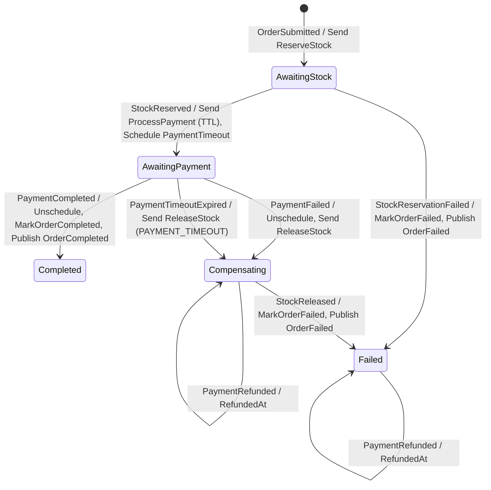

# Order saga

`Ordering.Application/Saga/OrderStateMachine.cs` · CorrelationId = OrderId · state tablosu `OrderState`.

## State diyagramı

## Geçiş matrisi

| State | İşlenen event'ler | Diğer tüm event'ler |
|---|---|---|
| AwaitingStock | `StockReserved`, `StockReservationFailed` | Ignore |
| AwaitingPayment | `PaymentCompleted`, `PaymentFailed`, `PaymentTimeoutExpired` | Ignore |
| Compensating | `StockReleased`, `PaymentCompleted` (refund), `PaymentRefunded` | Ignore |
| Completed | — | Ignore |
| Failed | `PaymentCompleted` (refund), `PaymentRefunded` | Ignore |

Listelenmeyen her (state, event) çifti **açıkça `Ignore()`** edilir (çift/geç teslim saga'yı hata kuyruğuna düşürmez).
`OrderSagaIgnoreMatrixTests` her state'te tüm işlenmeyen event'leri gönderir; bir Ignore unutulursa test kırılır.
Instance'ı olmayan bir event (bilinmeyen OrderId) ise bilinçli olarak fault → error kuyruğu (bug görünür olsun).

## Veri ve transaction

- **Saga kalemleri state'te (`OrderState.Items`, jsonb).** Saga Order tablosundan okumaz; saga'nın ihtiyacı olan veri
  `OrderSubmitted` ile gelir. `ProcessPayment.Amount/Currency` = `OrderSubmitted.TotalAmount/Currency` (yeniden hesaplanmaz).
- **Tek DbContext, tek transaction.** Saga repository (`ExistingDbContext<OrderDbContext>`), `MarkOrderCompleted`/
  `MarkOrderFailed` activity'leri (Order aggregate'ini günceller, kendileri SaveChanges çağırmaz) ve EF outbox aynı
  scoped `OrderDbContext`'i kullanır: saga state + sipariş durumu + giden mesajlar atomik commit edilir.
  `OrderCompleted`/`OrderFailed` yalnızca dış dünya içindir; sipariş durumunu güncellemek için tüketilmezler.
- **Completed/Failed final değil (`Finalize`/`SetCompletedWhenFinalized` yok).** Saga kaydı denetim izi olarak kalır
  (hangi state'ten, hangi sebeple, ne zaman) ve bu state'lerde geç gelen event'ler (örn. timeout sonrası
  `PaymentCompleted`) hâlâ karşılanabilir. Kayıt silinseydi geç event "missing instance" olarak hataya düşerdi.
  Temizlik/arşivleme gerekirse ayrı bir retention job'ı ile yapılır.

## Concurrency ve retry

- **Optimistic concurrency (Postgres `xmin`).** `OrderState.RowVersion` ve Order'da shadow `RowVersion` (`uint`,
  `IsRowVersion()`) fiziksel kolon eklemeden `xmin`'e eşlenir. Pessimistic kilit yerine çakışmada retry.
- **Endpoint filtre sırası** (`Ordering.Infrastructure/Saga/OrderStateDefinition`): `UseMessageRetry` (dışta) →
  `UseEntityFrameworkOutbox` (içte). Her deneme yeni transaction; inbox (`InboxState`) MessageId tekrarını, outbox
  giden mesajları saga state ile aynı transaction'a bağlar.
- **Retry kapsamı (`BuildingBlocks.Messaging.TransientDatabaseRetry`, Inventory/Payments de kullanacak):**
  `DbUpdateConcurrencyException`; `DbUpdateException` + 23505 (Initial'da aynı CorrelationId ile eşzamanlı insert —
  retry'da instance bulunur ve event doğru işlenir); `NpgsqlException.IsTransient`. Üstel bekleme (5 deneme,
  50 ms–2 s, delta 100 ms; MassTransit aralığı ±%20 rastgele seçer = jitter). Domain exception'ları
  (`OrderDomainException`) `Ignore` edilir.

## Timeout ve refund

- **Zamanlayıcı: Quartz (MassTransit.Quartz, in-process) + Postgres ADO job store** (`order_db`, `quartz` şeması,
  `TablePrefix = quartz.qrtz_`, SystemTextJson serializer, clustering açık → birden fazla API instance'ı aynı job'u
  iki kez çalıştırmaz). Quartz tabloları resmi script'ten (`Persistence/Sql/quartz_tables_postgres.sql`, Quartz 3.22.6)
  EF migration (`AddPaymentTimeoutScheduling`) ile kurulur. Saga tarafı: `AddPublishMessageScheduler` +
  `AddQuartzConsumers` + `UsePublishMessageScheduler`.
- `PaymentTimeoutExpired` saga'nın kendine gönderdiği iç mesajdır (Ordering.Application'da, Shared.Contracts'ta değil).
- **`PaymentTimeout` (varsayılan 30 sn, `OrderSaga:PaymentTimeout`) iki katmanlıdır:**
  1. `ProcessPayment` **TimeToLive = PaymentTimeout** ile gönderilir: timeout'tan sonra kuyrukta bekleyen bayat komut
     Payments'a hiç ulaşmaz (RabbitMQ siler) → gereksiz tahsilat + iade sayısı azalır.
  2. Aynı süreyle `PaymentTimeoutExpired` schedule edilir; `PaymentCompleted`/`PaymentFailed` gelince `Unschedule`.
  TTL tek başına yetmez: Payments komutu TTL dolmadan almış ve işliyor olabilir. Bu yüzden Compensating/Failed'de gelen
  geç `PaymentCompleted` için **bir kez** `RefundPayment` gönderilir (`RefundRequestedAt`; Amount/Currency
  `PaymentCompleted`'tan); `PaymentRefunded` gelince `RefundedAt` yazılır, sipariş Failed kalır. Unschedule ile yarışan
  geç timeout Completed/Compensating/Failed'de Ignore edilir.
- **Bilinen risk (kabul edildi):** timeout sonrası geç ödeme → para çekilir, sipariş Failed olur, sonra iade edilir.
  Müşteri kısa süreliğine çift hareket görebilir.

## Testler (Ordering.UnitTests/Saga)

- `AddMassTransitTestHarness` + in-memory saga repository + fake `IOrderRepository`. Zamanlayıcı olarak Quartz yerine
  **in-memory delayed scheduler** (saga arkadaki scheduler'ı bilmez). Harness'ta zamanı ileri alan API yok; timeout
  testleri `PaymentTimeout = 250 ms` ile çalışır (gerçek ama kısa bekleme). Quartz kurulumu Adım 5 entegrasyon testinde.
- Bekleme: harness'ın `Any()`'si inactivity timeout'a bağlı (Exists() yoklamaları aktivite sayılmaz) ve mesaj işlenmeden
  false dönebiliyor; testler kayıtlı mesajları senkron yoklar (`WaitUntilAsync`).
- Kapsam: happy path, stok yetersiz, ödeme başarısız, timeout, timeout sonrası geç ödeme → tek refund, çift event,
  Amount'un OrderSubmitted.TotalAmount'tan gelmesi, ProcessPayment TTL, state × event Ignore matrisi.
